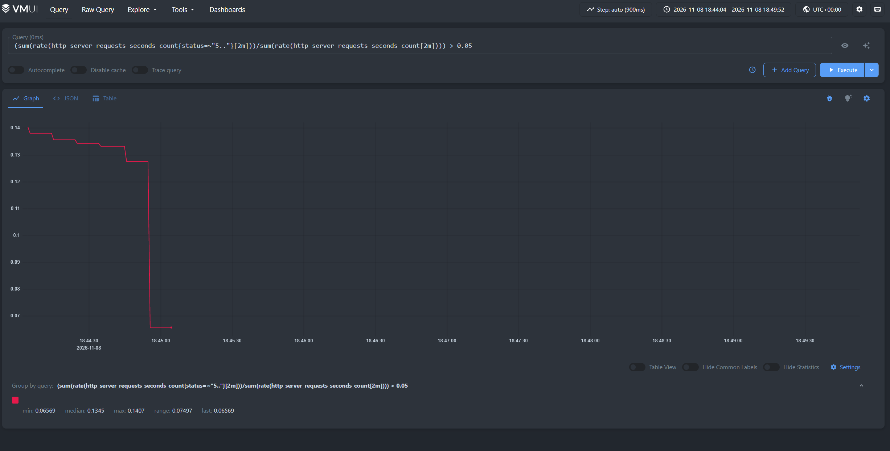
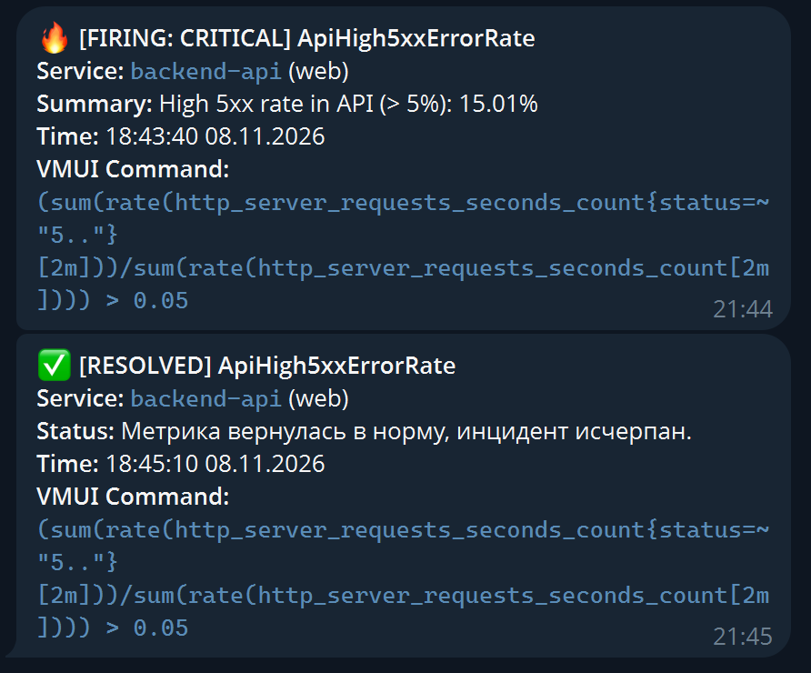
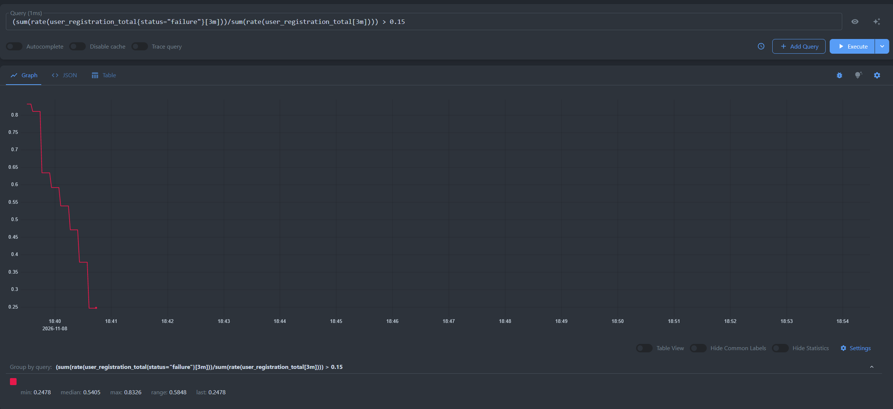
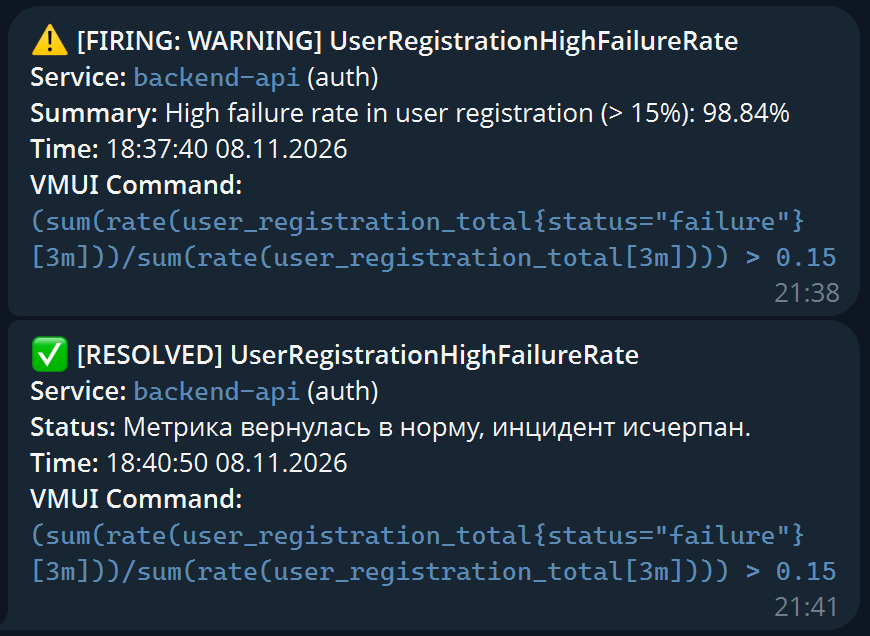
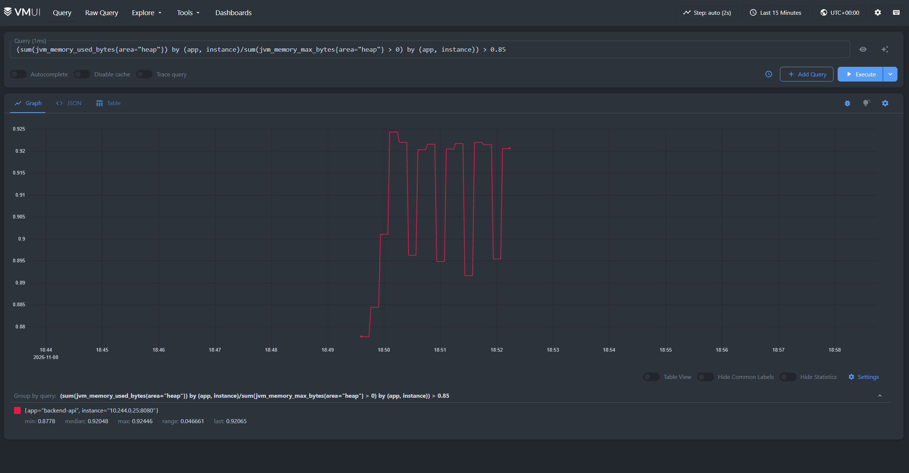
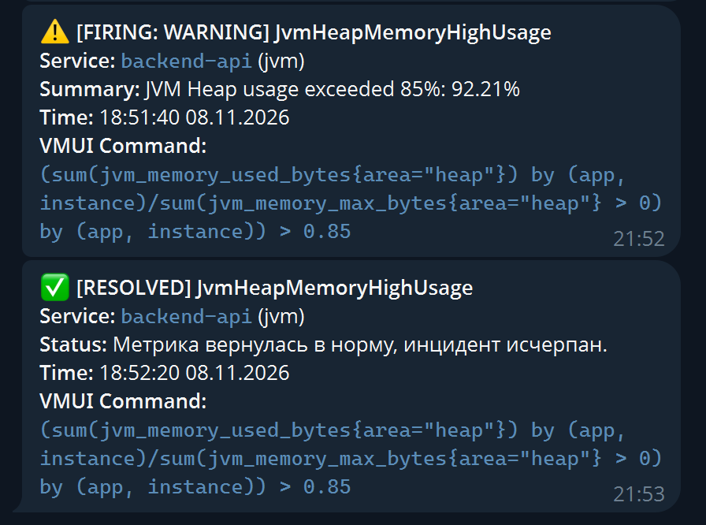
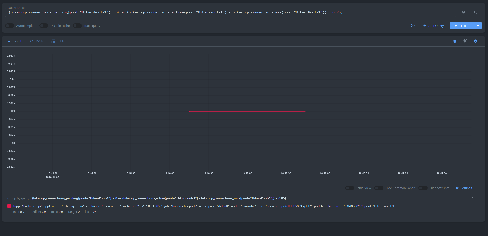
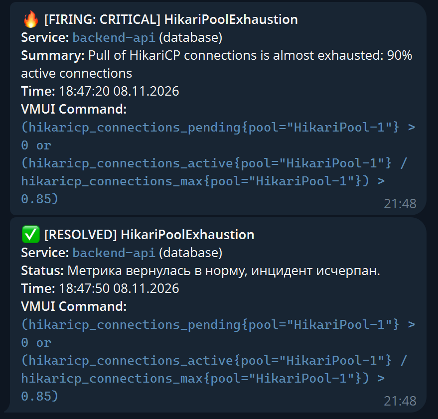

# Отчёт

## 1. Стек технологий мониторинга и алертинга

* **Хранилище временных рядов (TSDB):** VictoriaMetrics Single (`vm-single:8428`) - централизованный сбор и хранение метрик приложений, рантайма JVM и базы данных PostgreSQL.
* **Движок оценки правил алертинга:** VictoriaMetrics Alert (`vmalert:8880`) - непрерывно выполняет запросы на языке PromQL/MetricsQL к TSDB с интервалом `evaluation_interval: 10s`, отслеживает жизненный цикл состояний алертов (*Inactive* $\to$ *Pending* $\to$ *Firing* $\to$ *Resolved*) и передает активные события в диспетчер уведомлений.
* **Диспетчер и маршрутизатор уведомлений:** Prometheus Alertmanager v0.27.0 (`alertmanager:9093`) - выполняет дедупликацию, группировку, сглаживание штормов алертов (throttling), каскадную маршрутизацию по уровням критичности (`severity`) и отправку уведомлений во внешние каналы связи.
* **Каналы доставки оповещений:** Telegram Bot API с каскадным разделением:
  * **Критический бот (Incident / Critical Bot):** канал экстренного реагирования дежурного инженера / SRE на сбои доступности сервиса и исчерпание ключевых ресурсов.
  * **Информационный бот (Warning / Dev Bot):** канал предупреждений для команды разработки о деградации бизнес-метрик и превышении порогов использования памяти.
* **Среда оркестрации и декларативного управления:** Kubernetes v1.39.0 (Minikube), декларативная сборка и деплой через **Kustomize** с изоляцией секретов в **Kubernetes Secret**.

---

## 2. Alerting Rules

В файле конфигурации `k8s/alerting/rules.yml` реализовано **4 правила алертинга**, разделенные на две логические группы: **сервисные алерты** (бизнес-логика и доступность API) и **рантайм-алерты фреймворка / JVM** (Spring Boot Actuator и пул соединений HikariCP).

### 2.1. Сервисные алерты (Service & Business Metrics)

#### Алерт 1: `ApiHigh5xxErrorRate`
* **Severity**: Critical
* **PromQL-выражение:**
  ```promql
  (
    sum(rate(http_server_requests_seconds_count{status=~"5.."}[2m]))
    /
    sum(rate(http_server_requests_seconds_count[2m]))
  ) > 0.05
  ```
* **Параметры:** Порог $> 5\%$, окно агрегации $2m$, время удержания `for: 1m`.
* **Описание & обоснование:** 
  Появление ошибок серии $5xx$ свидетельствует о внутренних непредвиденных сбоях бэкенда (SLI 2/ SLO 2 Дз 5). Окно в 1 минуту отсекает единичные случайные всплески. Статус `critical`, так как появление подобных ошибок напрямую сигнализирует об остановке сервиса.

#### Алерт 2: `UserRegistrationHighFailureRate` 
* **Severity**: Warning
* **PromQL-выражение:**
  ```promql
  (
    sum(rate(user_registration_total{status="failure"}[3m]))
    /
    sum(rate(user_registration_total[3m]))
  ) > 0.15
  ```
* **Параметры:** Порог $> 15\%$, окно агрегации $3m$, время удержания `for: 1m`.
* **Описание & обоснование:** 
  Метрика фиксирует отказы регистрации. Рост доли неудач выше $15\%$ на протяжении 3 минут указывает на возможные проблемы в пользовательском интерфейсе (UX-баг), атаку подбора логинов (брутфорс/спам) либо рассинхронизацию валидации между фронтендом и бэкендом (SLI 1, SLO 1 Дз 5). Cтатус `warning`, поскольку общий сервис доступен, однако конверсия ключевого бизнес-процесса деградирует.

---

### 2.2. Рантайм-алерты актуатора и фреймворка (Runtime & Actuator Metrics)

#### Алерт 3: `HikariPoolExhaustion`
* **Severity**: Critical
* **PromQL-выражение:**
  ```promql
  (
    hikaricp_connections_pending{pool="HikariPool-1"} > 0
    or
    (hikaricp_connections_active{pool="HikariPool-1"} / hikaricp_connections_max{pool="HikariPool-1"}) > 0.85
  )
  ```
* **Параметры:** Наличие ожидающих потоков (`pending > 0`) или утилизация пула $> 85\%$, время удержания `for: 1m`, уровень `severity: critical`.
* **Описание & обоснование:** 
  Исчерпание соединений в пуле HikariCP и появление запросов, заблокированных в очереди ожидания соединения с СУБД. Если `hikaricp_connections_pending > 0`, это означает, что входящие HTTP-потоки заблокированы в ожидании освобождения коннекта к PostgreSQL (SLI 3, SLO 3 Дз 5). Порог $85\%$ позволяет зафиксировать дефицит до наступления полного отказа. Статус `critical`, так как промедление приведет к зависанию всего сервиса.

#### Алерт 4: `JvmHeapMemoryHighUsage`
* **Severity**: Warning
* **PromQL-выражение:**
  ```promql
  (
    sum(jvm_memory_used_bytes{area="heap"}) by (app, instance)
    /
    sum(jvm_memory_max_bytes{area="heap"} > 0) by (app, instance)
  ) > 0.85
  ```
* **Параметры:** Утилизация кучи $> 85\%$, время удержания `for: 2m`, уровень `severity: warning`.
* **Описание & обоснование:** 
  Превышение критического порога утилизации JVM Heap. Удержание уровня свыше $85\%$ в течение 2 минут исключает штатные пики перед циклом Major GC и сигнализирует о вероятной утечке памяти (Memory Leak) или необходимости масштабирования лимитов памяти пода (`limits.memory`) (влияние на доступность и задержки SLI 1, SLI 2, SLI 3 Дз 5). Статус `warning` выбран потому, что при утилизации $85\%$ приложение ещё способно штатно обрабатывать клиентские запросы (текущий SLA/SLO не нарушен, ошибок $5xx$ нет).

---

### 2.3. Полный листинг конфигурации правил `rules.yml`

```yaml
groups:
  - name: uchebny_radar_service_alerts
    rules:
      - alert: ApiHigh5xxErrorRate
        expr: |
          (
            sum(rate(http_server_requests_seconds_count{status=~"5.."}[2m]))
            /
            sum(rate(http_server_requests_seconds_count[2m]))
          ) > 0.05
        for: 1m
        labels:
          severity: critical
          service: backend-api
          component: web
        annotations:
          summary: "High 5xx rate in API (> 5%): {{ $value | humanizePercentage }}"
          command: "(sum(rate(http_server_requests_seconds_count{status=~\"5..\"}[2m]))/sum(rate(http_server_requests_seconds_count[2m]))) > 0.05"

      - alert: UserRegistrationHighFailureRate
        expr: |
          (
            sum(rate(user_registration_total{status="failure"}[3m]))
            /
            sum(rate(user_registration_total[3m]))
          ) > 0.15
        for: 1m
        labels:
          severity: warning
          service: backend-api
          component: auth
        annotations:
          summary: "High failure rate in user registration (> 15%): {{ $value | humanizePercentage }}"
          command: "(sum(rate(user_registration_total{status=\"failure\"}[3m]))/sum(rate(user_registration_total[3m]))) > 0.15"

  - name: uchebny_radar_runtime_alerts
    rules:
      - alert: HikariPoolExhaustion
        expr: |
          (
            hikaricp_connections_pending{pool="HikariPool-1"} > 0
            or
            (hikaricp_connections_active{pool="HikariPool-1"} / hikaricp_connections_max{pool="HikariPool-1"}) > 0.85
          )
        for: 1m
        labels:
          severity: critical
          service: backend-api
          component: database
        annotations:
          summary: "Pull of HikariCP connections is almost exhausted: {{ $value | humanizePercentage }} active connections"
          command: "(hikaricp_connections_pending{pool=\"HikariPool-1\"} > 0 or (hikaricp_connections_active{pool=\"HikariPool-1\"} / hikaricp_connections_max{pool=\"HikariPool-1\"}) > 0.85)"
          
      - alert: JvmHeapMemoryHighUsage
        expr: |
          (
            sum(jvm_memory_used_bytes{area="heap"}) by (app, instance)
            /
            sum(jvm_memory_max_bytes{area="heap"} > 0) by (app, instance)
          ) > 0.85
        for: 2m
        labels:
          severity: warning
          service: backend-api
          component: jvm
        annotations:
          summary: "JVM Heap usage exceeded 85%: {{ $value | humanizePercentage }}"
          command: "(sum(jvm_memory_used_bytes{area=\"heap\"}) by (app, instance)/sum(jvm_memory_max_bytes{area=\"heap\"} > 0) by (app, instance)) > 0.85"
```

---

## 3. Каскадная маршрутизация и Alertmanager

### 3.1. Принцип каскадной маршрутизации (Routing Tree)

1. **Корневой маршрут (`root route`):** Задает базовую группировку по имени алерта и сервису (`group_by: ['alertname', 'service']`), чтобы однотипные сбои на разных репликах объединялись в одну карточку события.
2. **Ветка Critical (`severity = "critical"`):**
   * Направляется в ресивер `telegram-critical` (Импровизированный бот дежурных инженеров).
   * Минимальная задержка отправки (`group_wait: 10s`) 
   * Частый интервал напоминания (`repeat_interval: 1h`)
3. **Ветка Warning (`severity = "warning"`):**
   * Направляется в ресивер `telegram-warning` (Импровизированный бот команды разработки).
   * Повышенный интервал сглаживания (`group_wait: 30s`) 
   * Редкий интервал повтора (`repeat_interval: 12h`) 

```
                    [ Входящий алерт от vmalert ]
                                 │
                   ( group_by: [alertname, service] )
                                 │
            ┌────────────────────┴────────────────────┐
            ▼                                         ▼
   match: severity = critical                match: severity = warning
            │                                         │
   group_wait: 10s                           group_wait: 30s
   repeat_interval: 1h                       repeat_interval: 12h
            │                                         │
            ▼                                         ▼
[ Receiver: telegram-critical ]           [ Receiver: telegram-warning ]
    (Incident / On-Call Bot)                    (Warning / Dev Bot)
```


### 3.2. Конфигурация Alertmanager (`alertmanager.yml`)

```yaml
global:
  resolve_timeout: 5m

route:
  receiver: 'telegram-critical'
  group_by: ['alertname', 'service']
  group_wait: 10s
  group_interval: 30s
  repeat_interval: 4h

  routes:
    # 1. Каскадная ветка: Критические алерты (CRITICAL)
    - matchers:
        - severity = "critical"
      receiver: 'telegram-critical'
      group_wait: 10s
      repeat_interval: 1h

    # 2. Каскадная ветка: Предупреждения (WARNING)
    - matchers:
        - severity = "warning"
      receiver: 'telegram-warning'
      group_wait: 30s
      repeat_interval: 12h

receivers:
  # Канал критических сбоев
  - name: 'telegram-critical'
    telegram_configs:
      - bot_token_file: '/etc/secrets/critical_token'
        chat_id: 704462347
        send_resolved: true
        parse_mode: 'HTML'
        message: |
          {{ range .Alerts }}
          {{ if eq .Status "firing" }}🔥 <b>[FIRING: {{ .Labels.severity | toUpper }}]</b> <b>{{ .Labels.alertname }}</b>
          <b>Service:</b> <code>{{ .Labels.service }}</code> ({{ .Labels.component }})
          <b>Summary:</b> {{ .Annotations.summary }}
          <b>Time:</b> {{ .StartsAt.Format "15:04:05 02.01.2006" }}
          <b>VMUI Command:</b> <code>{{ .Annotations.command }}</code>
          {{ else }}✅ <b>[RESOLVED]</b> <b>{{ .Labels.alertname }}</b>
          <b>Service:</b> <code>{{ .Labels.service }}</code> ({{ .Labels.component }})
          <b>Status:</b> Метрика вернулась в норму, инцидент исчерпан.
          <b>Time:</b> {{ .EndsAt.Format "15:04:05 02.01.2006" }}
          <b>VMUI Command:</b> <code>{{ .Annotations.command }}</code>
          {{ end }}
          {{ end }}

  # Канал предупреждений
  - name: 'telegram-warning'
    telegram_configs:
      - bot_token_file: '/etc/secrets/warning_token'
        chat_id: 704462347
        send_resolved: true
        parse_mode: 'HTML'
        message: |
          {{ range .Alerts }}
          {{ if eq .Status "firing" }}⚠️ <b>[FIRING: {{ .Labels.severity | toUpper }}]</b> <b>{{ .Labels.alertname }}</b>
          <b>Service:</b> <code>{{ .Labels.service }}</code> ({{ .Labels.component }})
          <b>Summary:</b> {{ .Annotations.summary }}
          <b>Time:</b> {{ .StartsAt.Format "15:04:05 02.01.2006" }}
          <b>VMUI Command:</b> <code>{{ .Annotations.command }}</code>
          {{ else }}✅ <b>[RESOLVED]</b> <b>{{ .Labels.alertname }}</b>
          <b>Service:</b> <code>{{ .Labels.service }}</code> ({{ .Labels.component }})
          <b>Status:</b> Метрика вернулась в норму, инцидент исчерпан.
          <b>Time:</b> {{ .EndsAt.Format "15:04:05 02.01.2006" }}
          <b>VMUI Command:</b> <code>{{ .Annotations.command }}</code>
          {{ end }}
          {{ end }}
```

---

## 4. Развертывание в Kubernetes через единый Kustomize

Вся система алертинга объединена в единый декларативный конвейер развертывания проекта в корневом файле `k8s/kustomization.yaml`:

```yaml
apiVersion: kustomize.config.k8s.io/v1beta1
kind: Kustomization

resources:
  - config.yml
  - secret.yml
  - postgres.yml
  - backend.yml
  - worker.yml
  - frontend.yml
  - victoria-logs.yml
  - vector.yml
  - grafana.yml
  - alerting/alertmanager-deploy.yml
  - alerting/vmalert-deploy.yml

configMapGenerator:
  - name: alertmanager-config
    namespace: monitoring
    files:
      - alertmanager.yml=alerting/alertmanager.yml
    options:
      disableNameSuffixHash: true
  - name: vmalert-rules
    namespace: monitoring
    files:
      - rules.yml=alerting/rules.yml
    options:
      disableNameSuffixHash: true
```

---

## 5. Скриншоты работы системы алертинга

В ходе тестирования системы были проверены сценарии срабатывания всех 4 настроенных правил алертинга (2 сервисных и 2 рантайм-алерта) с фиксацией графиков метрик в VictoriaMetrics UI (VMUI) и сквозной доставкой уведомлений о переходе в статус `FIRING` и автоматическом снятии в статус `RESOLVED` с раздельным шаблоном статуса через соответствующие Telegram-боты Alertmanager.

---

### 5.1. Критический алерт доступности API (`ApiHigh5xxErrorRate`)

**Сценарий воспроизведения:** Включение режима генерации сбоев бэкенда через тестовый эндпоинт `POST /api/chaos/enable` под входящей нагрузкой от фонового пробера.

1. **График всплеска и нормализации ошибок $5xx$ в VictoriaMetrics (VMUI):**  
   При активации режима хаоса доля пятисотых ошибок подскочила до пиковых значений ~15%, превысив порог алерта $> 5\%$. После отключения режима хаоса (`POST /api/chaos/disable`) уровень пятисотых ошибок плавно снизился до нуля, вернувшись в безопасную зону:
   
   

2. **Срабатывание и автоматическое восстановление (`FIRING` $\to$ `RESOLVED`) в дежурном Telegram-боте:**  
    Инцидент был маршрутизирован в канал инженеров со значением ошибки 15.01%. После нормализации метрики Alertmanager автоматически отправил подтверждение о снятии аварии с статусом восстановления:
   
   

---

### 5.2. Предупреждающий алерт бизнес-логики (`UserRegistrationHighFailureRate`)

**Сценарий воспроизведения:** Отправка серии конфликтующих HTTP-запросов на регистрацию с уже существующим в базе данных логином (`POST /api/auth/register`), вызывающих массовые ответы `400 / 409 Conflict`.

1. **График доли отказов регистрации в VictoriaMetrics (VMUI):**  
   Доля неудачных регистраций выросла до ~83–98%, существенно превысив допустимый порог в 15%, а после возобновления нормальной регистрации плавно спала ниже порога:
   
   

2. **Срабатывание и автоматическое восстановление (`FIRING` $\to$ `RESOLVED`) в информационном боте:**  
   Событие с `severity: warning` поступило во второй Telegram-бот (канал команды разработки) со значением отказов 98.84%, а после прекращения конфликтующих запросов автоматически перешло в статус `RESOLVED`:
   
   

---

### 5.3. Предупреждающий рантайм-алерт памяти JVM (`JvmHeapMemoryHighUsage`)

**Сценарий воспроизведения:** Эмуляция повышенного выделения объектов в куче JVM под нагрузкой в контейнере `backend-api` с ограничением пула памяти, приведшая к удержанию утилизации Heap свыше 85% на протяжении более 2 минут.

1. **График утилизации Heap-памяти в VictoriaMetrics (VMUI):**  
   В VMUI зафиксирован устойчивый рост и удержание процента использования кучи JVM на подах бэкенда на уровне ~92% (при пороге срабатывания 85%):
   
   

2. **Срабатывание и автоматическое восстановление (`FIRING` $\to$ `RESOLVED`) в информационном Telegram-боте:**  
   Алерт предупреждения поступил в Telegram канал разработчиков с текущим значением потребления кучи (92.21%) , а после снятия ограничения памяти и перезапуска пода перешёл в состояние `RESOLVED`:
   
   

---

### 5.4. Критический рантайм-алерт пула соединений базы данных (`HikariPoolExhaustion`)

**Сценарий воспроизведения:** Создание параллельных транзакций с блокировкой таблицы `users` в PostgreSQL и удержанием 9 активных соединений из 10 (`active/max = 90% > 85%`) в пуле HikariCP.

1. **График утилизации пула соединений в VictoriaMetrics (VMUI):**  
   В VMUI отображена фиксация утилизации пула `HikariPool-1` на критическом уровне 0.9 (90% активных коннектов пула):
   
   

2. **Срабатывание и автоматическое снятие (`FIRING` $\to$ `RESOLVED`) в дежурном Telegram-боте:**  
   Алерт был доставлен в Telegram канал инженеров (90% активных соединений), после снятия блокировки и завершения транзакций алерт был снят и было выслано уведомление  `[RESOLVED]`:
   
   
