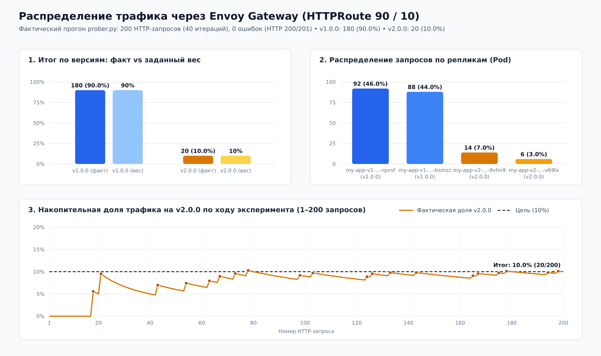

# Отчёт по балансировке трафика через Gateway API (90/10)

## 1. Что развёрнуто в Minikube

Для проверки разделения трафика по весам в namespace `default` подняты две версии бэкенда `uchebny-radar-backend:latest` (по 2 реплики на версию), а базовый `backend-api` переведён в `replicas: 0`, чтобы весь входящий трафик шёл исключительно через `v1` и `v2`:

- **`my-app-v1`** (`APP_VERSION=v1.0.0`, 2 Pod'а) + отдельный `ClusterIP` Service `my-app-v1` (`80 -> 8080`).
- **`my-app-v2`** (`APP_VERSION=v2.0.0`, 2 Pod'а) + отдельный `ClusterIP` Service `my-app-v2` (`80 -> 8080`).
- **Envoy Gateway**: контроллер `envoy-gateway` в `envoy-gateway-system` обслуживает `GatewayClass` `scheduler-sre-gateway-class` и поднимает прокси-под под `Gateway` `scheduler-sre-gateway-backend` (`HTTP:80`).
- **Маршрут `HTTPRoute` `scheduler-sre-routes`**: прикреплён к `scheduler-sre-gateway-backend` и в одном правиле делит трафик между `my-app-v1` (`weight: 90`) и `my-app-v2` (`weight: 10`).

Обе версии используют общую PostgreSQL (`postgres:5432`) и хранят HTTP-сессии в БД (`spring.session.store-type: jdbc`), поэтому даже если соседние запросы одного клиента попадают на `v1` и `v2` вперемешку, сессия и CSRF-токен не теряются. Фильтр `PodInfoFilter` добавляет в каждый HTTP-ответ заголовки `X-App-Version` и `X-Pod-Name`, по которым пробер однозначно фиксирует обработавшую запрос версию и конкретный Pod.

---

## 2. YAML-манифесты

### 2.1. `GatewayClass` (`k8s/balancer/GatewayClass.yml`)

```yaml
apiVersion: gateway.networking.k8s.io/v1
kind: GatewayClass
metadata:
  name: scheduler-sre-gateway-class
spec:
  controllerName: gateway.envoyproxy.io/gatewayclass-controller
```

### 2.2. `Gateway` (`k8s/balancer/Gateway.yml`)

```yaml
apiVersion: gateway.networking.k8s.io/v1
kind: Gateway
metadata:
  name: scheduler-sre-gateway-backend
  namespace: default
spec:
  gatewayClassName: scheduler-sre-gateway-class
  listeners:
    - name: http
      protocol: HTTP
      port: 80
```

### 2.3. `HTTPRoute` (`k8s/balancer/HttpRoute.yml`)

```yaml
apiVersion: gateway.networking.k8s.io/v1
kind: HTTPRoute
metadata:
  name: scheduler-sre-routes
spec:
  parentRefs:
    - name: scheduler-sre-gateway-backend
  rules:
    -  backendRefs:
        - name: my-app-v1
          port: 80
          weight: 90
        - name: my-app-v2
          port: 80
          weight: 10
```

### 2.4. Версия v1.0.0 — `Service` (`ClusterIP`) и `Deployment` (`k8s/strategies/app/app-v1.yaml`)

```yaml
apiVersion: v1
kind: Service
metadata:
  name: my-app-v1
  namespace: default
  labels:
    app: my-app
    version: v1.0.0
spec:
  selector:
    app: my-app
    version: v1.0.0
  ports:
    - name: http
      port: 80
      targetPort: 8080
    - name: metrics
      port: 8080
      targetPort: 8080
  type: ClusterIP
---
apiVersion: apps/v1
kind: Deployment
metadata:
  name: my-app-v1
  namespace: default
  labels:
    app: my-app
    version: v1.0.0
spec:
  replicas: 2
  selector:
    matchLabels:
      app: my-app
      version: v1.0.0
  template:
    metadata:
      labels:
        app: my-app
        version: v1.0.0
      annotations:
        prometheus.io/scrape: "true"
        prometheus.io/port: "8080"
        prometheus.io/path: "/actuator/prometheus"
    spec:
      containers:
        - name: backend-api
          image: uchebny-radar-backend:latest
          imagePullPolicy: IfNotPresent
          ports:
            - name: http
              containerPort: 8080
          env:
            - name: JAVA_TOOL_OPTIONS
              value: "-Xms128m -Xmx256m -XX:+UseSerialGC"
            - name: APP_ROLE
              value: "api"
            - name: APP_WORKER_ENABLED
              value: "false"
            - name: APP_VERSION
              value: "v1.0.0"
            - name: POD_NAME
              valueFrom:
                fieldRef:
                  fieldPath: metadata.name
            - name: SPRING_DATASOURCE_URL
              value: "jdbc:postgresql://postgres.default.svc.cluster.local:5432/uchebny_radar"
            - name: SPRING_DATASOURCE_USERNAME
              value: "postgres"
            - name: SPRING_DATASOURCE_PASSWORD
              value: "pass"
          startupProbe:
            httpGet:
              path: /actuator/health/liveness
              port: 8080
            failureThreshold: 30
            periodSeconds: 5
          readinessProbe:
            httpGet:
              path: /actuator/health/readiness
              port: 8080
            periodSeconds: 5
          livenessProbe:
            httpGet:
              path: /actuator/health/liveness
              port: 8080
            periodSeconds: 10
          resources:
            requests:
              cpu: 100m
              memory: 384Mi
            limits:
              cpu: 500m
              memory: 768Mi
```

### 2.5. Версия v2.0.0 — `Service` (`ClusterIP`) и `Deployment` (`k8s/strategies/app/app-v2.yaml`)

```yaml
apiVersion: v1
kind: Service
metadata:
  name: my-app-v2
  namespace: default
  labels:
    app: my-app
    version: v2.0.0
spec:
  selector:
    app: my-app
    version: v2.0.0
  ports:
    - name: http
      port: 80
      targetPort: 8080
    - name: metrics
      port: 8080
      targetPort: 8080
  type: ClusterIP
---
apiVersion: apps/v1
kind: Deployment
metadata:
  name: my-app-v2
  namespace: default
  labels:
    app: my-app
    version: v2.0.0
spec:
  replicas: 2
  selector:
    matchLabels:
      app: my-app
      version: v2.0.0
  template:
    metadata:
      labels:
        app: my-app
        version: v2.0.0
      annotations:
        prometheus.io/scrape: "true"
        prometheus.io/port: "8080"
        prometheus.io/path: "/actuator/prometheus"
    spec:
      containers:
        - name: backend-api
          image: uchebny-radar-backend:latest
          imagePullPolicy: IfNotPresent
          ports:
            - name: http
              containerPort: 8080
          env:
            - name: JAVA_TOOL_OPTIONS
              value: "-Xms128m -Xmx256m -XX:+UseSerialGC"
            - name: APP_ROLE
              value: "api"
            - name: APP_WORKER_ENABLED
              value: "false"
            - name: APP_VERSION
              value: "v2.0.0"
            - name: POD_NAME
              valueFrom:
                fieldRef:
                  fieldPath: metadata.name
            - name: SPRING_DATASOURCE_URL
              value: "jdbc:postgresql://postgres.default.svc.cluster.local:5432/uchebny_radar"
            - name: SPRING_DATASOURCE_USERNAME
              value: "postgres"
            - name: SPRING_DATASOURCE_PASSWORD
              value: "pass"
          startupProbe:
            httpGet:
              path: /actuator/health/liveness
              port: 8080
            failureThreshold: 30
            periodSeconds: 5
          readinessProbe:
            httpGet:
              path: /actuator/health/readiness
              port: 8080
            periodSeconds: 5
          livenessProbe:
            httpGet:
              path: /actuator/health/liveness
              port: 8080
            periodSeconds: 10
          resources:
            requests:
              cpu: 100m
              memory: 384Mi
            limits:
              cpu: 500m
              memory: 768Mi
```

---

## 3. Проверка распределения трафика пробером (200 запросов)

Для прогона использовался `prober/prober.py`, подключённый к новому Envoy-прокси через `port-forward`:

```bash
kubectl port-forward -n envoy-gateway-system \
  svc/envoy-default-scheduler-sre-gateway-backend-e2f49831 18080:80

PROBER_INTERVAL=0.05 python3 -u prober/prober.py http://127.0.0.1:18080
```

За 40 полных итераций пробер отправил **200 HTTP-запросов** (по 5 на итерацию: `GET /api/auth/csrf`, `POST /api/auth/register`, `POST /api/projects`, `POST /api/projects/{id}/tasks`, `GET /api/projects/{id}/tasks`). Полный необработанный лог прогона сохранён в [prober.log](prober.log).

### 3.1. Итоговые результаты

| Версия | Заданный вес | Получено запросов | Фактическая доля | Статусы ответов |
|---|---|---|---|---|
| `v1.0.0` (`my-app-v1`) | `90` (90%) | **180** | **90.0%** | `200`: 76, `201`: 104 (0 ошибок) |
| `v2.0.0` (`my-app-v2`) | `10` (10%) | **20** | **10.0%** | `200`: 4, `201`: 16 (0 ошибок) |
| **Всего** | **100** | **200** | **100.0%** | **`200`: 80, `201`: 120 (0 ошибок)** |

Разбивка по конкретным подам:

| Версия | Pod | Количество запросов | Доля от всех 200 |
|---|---|---|---|
| `v1.0.0` | `my-app-v1-5f7bdf654b-rpvsf` | 92 | 46.0% |
| `v1.0.0` | `my-app-v1-5f7bdf654b-bsmzz` | 88 | 44.0% |
| `v2.0.0` | `my-app-v2-64c87ff77d-9vhn9` | 14 | 7.0% |
| `v2.0.0` | `my-app-v2-64c87ff77d-v69lx` | 6 | 3.0% |

Время отклика по всем 200 запросам: минимум `0.014s`, медиана `0.028s`, `p95 = 0.227s`, максимум `1.997s` (холодный разогрев JVM/Tomcat на первых запросах).

Разбивка по эндпоинтам:

| Эндпоинт | Всего | `v1.0.0` | `v2.0.0` |
|---|---|---|---|
| `GET /api/auth/csrf` | 40 | 38 | 2 |
| `POST /api/auth/register` | 40 | 38 | 2 |
| `POST /api/projects` | 40 | 29 | 11 |
| `POST /api/projects/{id}/tasks` | 40 | 37 | 3 |
| `GET /api/projects/{id}/tasks` | 40 | 38 | 2 |

Динамика сходимости на контрольных отметках:

| Запросов всего | `v1.0.0` | `v2.0.0` | Накопительная доля `v2.0.0` |
|---:|---:|---:|---:|
| 20 | 19 | 1 | 5.0% |
| 40 | 38 | 2 | 5.0% |
| 60 | 56 | 4 | 6.7% |
| 80 | 72 | 8 | 10.0% |
| 100 | 91 | 9 | 9.0% |
| 120 | 110 | 10 | 8.3% |
| 140 | 127 | 13 | 9.3% |
| 160 | 146 | 14 | 8.8% |
| 180 | 162 | 18 | 10.0% |
| 200 | 180 | 20 | 10.0% |

### 3.2. График распределения трафика



### 3.3. Наглядный фрагмент логов пробера и Envoy

В фрагменте четвёртой итерации из [prober.log](prober.log) хорошо видно, как один и тот же сценарий без ошибок проходит через обе версии и разные поды: запрос `POST /api/projects` уходит на `v2.0.0`, а следующий `POST /api/projects/4/tasks` с тем же cookie возвращается на `v1.0.0`:

```text
2026-11-28 00:24:20 [INFO] ============================================================
2026-11-28 00:24:20 [INFO] Starting of prober integration (user: prober_4jhezmo2)
2026-11-28 00:24:20 [INFO] ============================================================
2026-11-28 00:24:20 [INFO] status=200  endpoint=GET /api/auth/csrf                   ver=v1.0.0   pod=my-app-v1-5f7bdf654b-rpvsf  duration=0.027s
2026-11-28 00:24:20 [INFO] status=201  endpoint=POST /api/auth/register              ver=v1.0.0   pod=my-app-v1-5f7bdf654b-rpvsf  duration=0.147s
2026-11-28 00:24:21 [INFO] status=201  endpoint=POST /api/projects                   ver=v2.0.0   pod=my-app-v2-64c87ff77d-9vhn9  duration=1.211s
2026-11-28 00:24:21 [INFO] status=201  endpoint=POST /api/projects/4/tasks           ver=v1.0.0   pod=my-app-v1-5f7bdf654b-rpvsf  duration=0.026s
2026-11-28 00:24:21 [INFO] status=200  endpoint=GET /api/projects/4/tasks            ver=v1.0.0   pod=my-app-v1-5f7bdf654b-bsmzz  duration=0.028s
2026-11-28 00:24:21 [INFO] Whole iteration completed for user: prober_4jhezmo2
```


В логах самого Envoy (`kubectl logs -n envoy-gateway-system -l gateway.envoyproxy.io/owning-gateway-name=scheduler-sre-gateway-backend -c envoy`) видно, что все запросы идут через кластер `httproute/default/scheduler-sre-routes/rule/0` и попадают на IP подов как `v1` (`10.244.0.14`, `10.244.0.15`), так и `v2` (`10.244.0.17` на шаге 40):

```json
{"method":"POST","response_code":201,"route_name":"httproute/default/scheduler-sre-routes/rule/0/match/0/*","upstream_cluster":"httproute/default/scheduler-sre-routes/rule/0","upstream_host":"10.244.0.15:8080","x-envoy-origin-path":"/api/auth/register"}
{"method":"POST","response_code":201,"route_name":"httproute/default/scheduler-sre-routes/rule/0/match/0/*","upstream_cluster":"httproute/default/scheduler-sre-routes/rule/0","upstream_host":"10.244.0.17:8080","x-envoy-origin-path":"/api/projects"}
{"method":"POST","response_code":201,"route_name":"httproute/default/scheduler-sre-routes/rule/0/match/0/*","upstream_cluster":"httproute/default/scheduler-sre-routes/rule/0","upstream_host":"10.244.0.14:8080","x-envoy-origin-path":"/api/projects/40/tasks"}
```

---

## 4. Вывод

Настроенная связка `GatewayClass` → `Gateway` → `HTTPRoute` работает корректно:

1. Из **200** отправленных через Envoy Gateway запросов **180** ушли в `my-app-v1` (`v1.0.0`) и **20** — в `my-app-v2` (`v2.0.0`), что составляет ровно **90.0% / 10.0%** и полностью соответствует заданным в `HTTPRoute` весам `90` и `10`.
2. На коротких отрезках (первые 40 запросов дали `5.0%` на `v2`) доля колеблется из-за вероятностного выбора бэкенда по весу, но с ростом числа запросов быстро стабилизируется около целевых 10%.
3. Внутри каждой версии Envoy равномерно нагружает обе реплики (`92` и `88` на подах `v1`; `14` и `6` на подах `v2`), а вынесенные в PostgreSQL сессии позволяют `v1` и `v2` прозрачно обрабатывать запросы одного пользователя без единой ошибки.
