# Отчёт 

## 1. Дашборд: «Uchebny Radar — SLA, SLI & SLO» 
Этот дашборд отображает SLI, SLA, SLO и метрики для пробера из домашнего задания 5 (ветка SLA)

### 1.1. Структура панелей

1. **SLA за 1 час:**
   * Расчет строится по методологии **Time-Based SLO**: определяется процент успешных минутных интервалов в скользящем окне за 1 час с помощью функции `count_over_time(...[1h:1m])`.
   * **Combined Application SLA (Gauge):** Главный интегральный показатель работоспособности приложения. Считает долю времени, когда одновременно выполняются критерии доступности (ошибок $5xx < 1\%$) и производительности (время отклика $p95 \le 500$ мс). Целевой порог — не менее **99.0%** (зеленая зона).
   * **SLA 1: Registration SLA (Stat):** Доля времени с успешной регистрацией пользователей ($\ge 95\%$). Цель: $\ge 99.0\%$.
   * **SLA 2: API Availability SLA (Stat):** Доля времени с успешными ответами API без пятисотых ошибок ($\ge 99\%$). Цель: $\ge 99.5\%$.
   * **SLA 3: Latency Compliance SLA (Stat):** Доля времени, когда задержка $p95$ укладывается в норматив $\le 500$ мс. Цель: $\ge 98.0\%$.
   * **SLA 4: ReminderWorker SLA (Stat):** Доля времени активной работы фонового воркера напоминаний. Цель: $\ge 95.0\%$.
   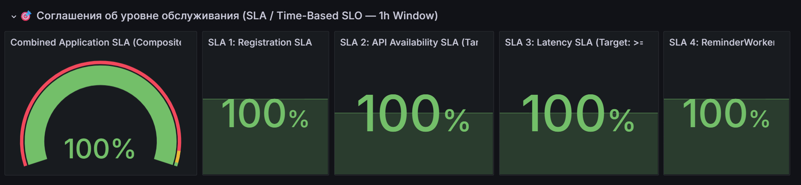

2. **SLI в реальном времени:**
   * Четыре графика временных рядов отображают текущие показатели SLI в динамике с шагом в 1 минуту.
   * На графиках явно нанесены пороги целевых соглашений SLO (горизонтальные маркеры: 95% для регистрации, 99% для API, 500 мс для $p95$ задержки). Это позволяет мгновенно локализовать секундные просадки и всплески latency.
   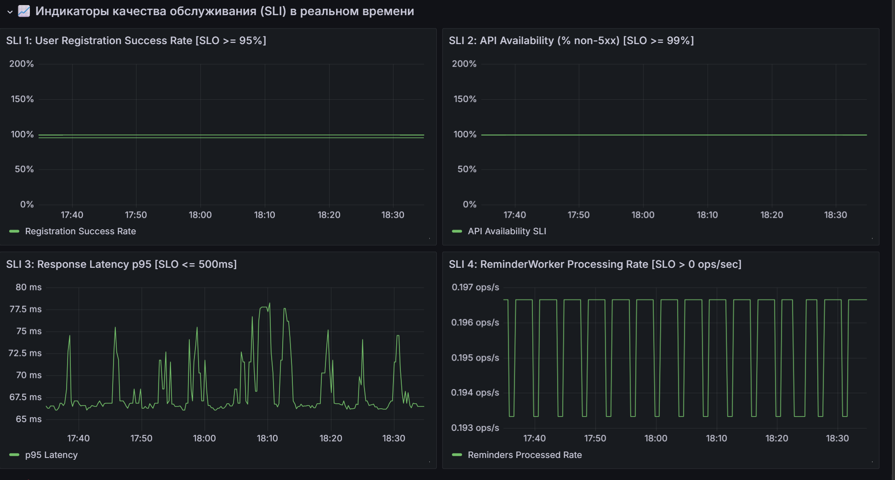

3. **Трафик пробера и динамика создания сущностей:**
   * **RED Traffic (RPS by Endpoint):** Интенсивность запросов синтетического клиента по каждому эндпоинту.
   * **Domain Entities Velocity:** Скорость создания учебных проектов, задач (с разбивкой по приоритетам `high`, `medium`, `low`) и темп обработки напоминаний воркером (`reminders_processed_total`).
   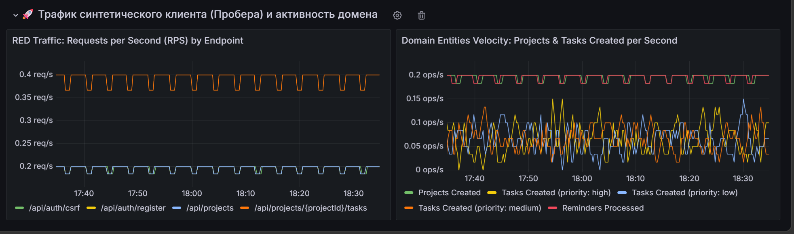

---

## 2. Дашборд состояния приложения: «Spring Boot 3.x Statistics»
### 2.1. Источник и адаптация дашборда
* **Источник:** дашборд **ID `19004` («Spring Boot 3.x Statistics»)**
* **Адаптация:** В исходном шаблоне селекторы переменных использовали строгое равенство `instance="$instance"`, из-за чего выбор нескольких подов или значения `All` приводил к ошибкам запросов (так как в проекте используется worker `10.244.0.x:8080` и сам backend сервис `10.244.0.y:8080`). В конфигурацию были внесены исправления: строгие операторы заменены на регулярные выражения (`=~"$instance"`), а инстансом по умолчанию выставлен основной `backend-api` (`10.244.0.9:8080`).

### 2.2. Краткое описание панелей

1. **Basic Statistics (Общее состояние):**
   * Отображает время непрерывной работы приложения (Uptime), момент старта сервиса, процент заполнения оперативной памяти JVM Heap и Non-Heap, утилизацию CPU (нагрузка процесса vs системы) и открытые файловые дескрипторы.
   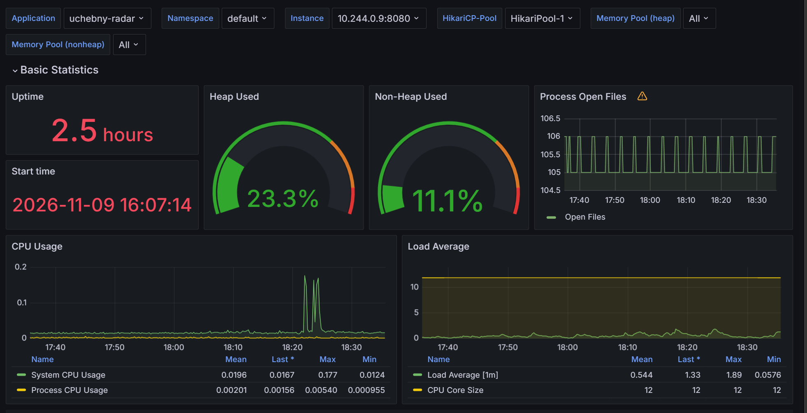
2. **HTTP Statistics (Подход RED / Golden Signals):**
   * **Rate (Интенсивность):** график *Request Count* показывает входящий RPS с разделением по HTTP-методам (`GET`, `POST`) и бизнес-путям API (`/api/auth/*`, `/api/projects/*`, `/api/tasks/*`).
   * **Duration (Задержка):** график *Response Time* отражает среднее и максимальное время обработки клиентских вызовов.
   * **Errors (Ошибки):** отслеживание статусов ответов и выявление всплесков $4xx$ и $5xx$.
   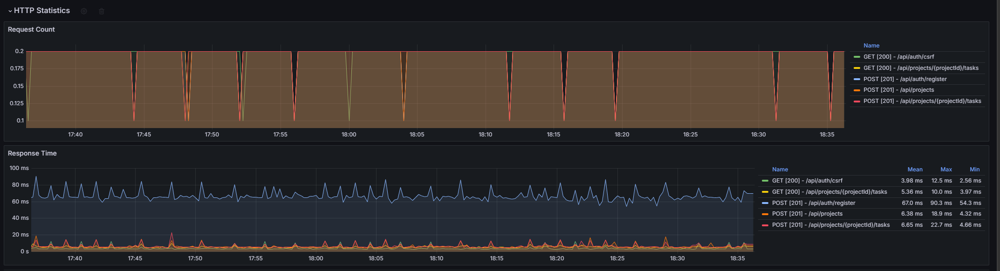
3. **JVM Memory & Garbage Collection (Подход USE / Saturation):**
   * Детализация пулов кучи HotSpot: `G1 Eden Space` (активное выделение объектов), `G1 Old Gen` (долгоживущие объекты) и `G1 Survivor Space`.
   * Мониторинг метапространства (`Metaspace`) и количества активных потоков Java (`Live Threads`).
   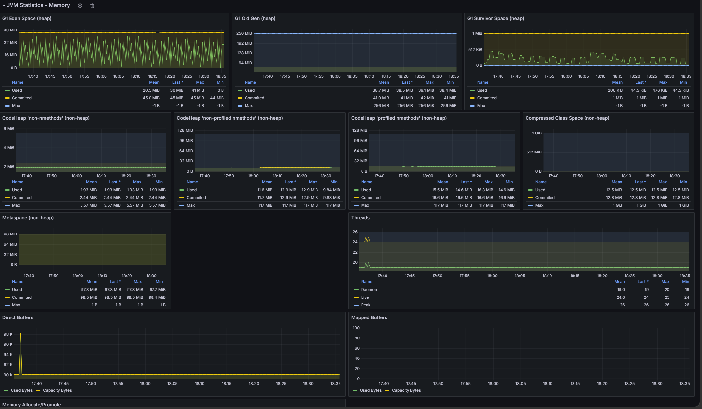
   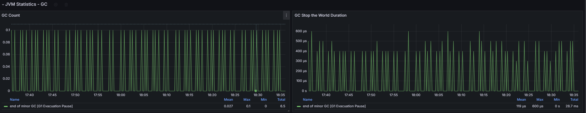
   * Метрики сборщика мусора: частота вызовов GC и длительность пауз *Stop-The-World*.
4. **Database Connection Pool HikariCP (USE / Bottlenecks):**
   * Мониторинг пула подключений к PostgreSQL: общий размер пула (10 соединений), число активных и простаивающих коннектов, тайминги создания (`Creation Time`), удержания (`Usage Time`) и ожидания коннекта потоками (`Acquire Time`).
   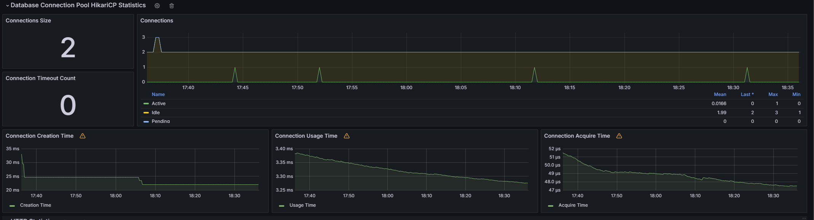
5. **Logback Statistics:**
   * Скорость генерации логов приложения по уровням серьезности (`INFO`, `WARN`, `ERROR`).
   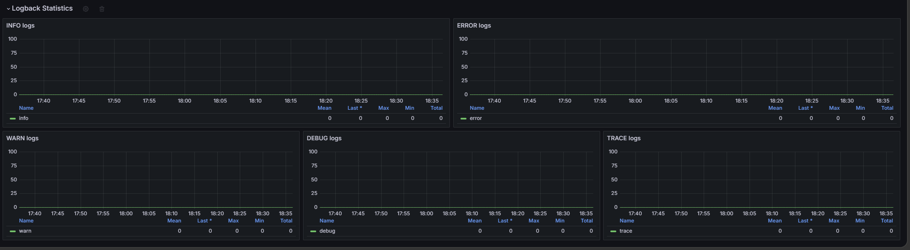

---

## 3. Дашборд PostgreSQL Exporter

### 3.1. Источник и подключение
* **Источник:** Официальный дашборд сообщества Prometheus — **ID `9628` («PostgreSQL Database»)** от автора *cverna*.
* **Подключение:** Работает со стандартным экспортером `prometheuscommunity/postgres-exporter:v0.15.0`, запущенным в качестве sidecar-контейнера в поде PostgreSQL (`10.244.0.2:9187`). Экспортированный артефакт сохранен в [`Reports/Grafana/dashboards/postgresql-database-dashboard.json`](file:///v:/SRE/scheduler_sre/Reports/Grafana/dashboards/postgresql-database-dashboard.json).

### 4.2. Краткое описание контролируемых показателей
1. **Конфигурация и окружение:** Версия PostgreSQL (`16.15.0`), лимит подключений (`Max Connections = 100`), размеры разделов памяти (`Shared Buffers = 128 MiB`, `Work Mem = 4 MiB`) и лимиты WAL.
2. **Сессии и активность:** Количество активных клиентских сессий и сессий в ожидании завершения транзакций (`idle in transaction`).
3. **Транзакции и throughput (TPS):** Темп фиксации транзакций (`commits`) и откатов (`rollbacks`).
4. **Эффективность кэширования (Cache Hit Rate):** Процент обращений к данным через оперативную память без обращения к диску ($> 99.8\%$).
5. **Операции со строками (DML Tuples):** Динамика операций чтения (`fetched`), вставки (`inserted`), обновления (`updated`) и удаления (`deleted`).
6. **Надежность и блокировки:** Табличные блокировки (`Lock tables`) и подтвержденное отсутствие взаимных блокировок (`Deadlocks = 0`).

### 4.3. Скриншоты дашборда PostgreSQL

#### Общие счетчики, системные параметры и настройки PostgreSQL
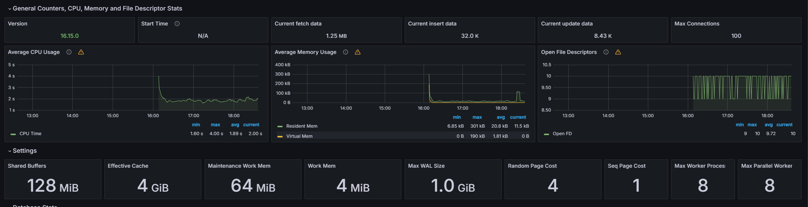

#### Статистика базы данных (Сессии, транзакции TPS, Cache Hit Rate, операции со строками)
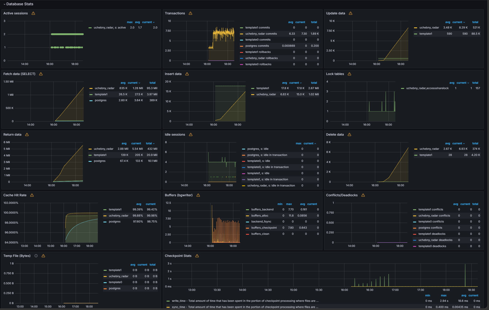
